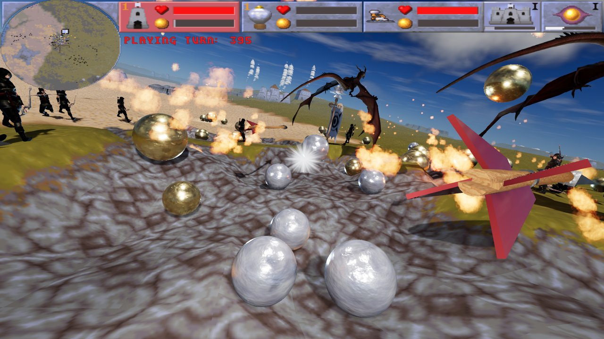
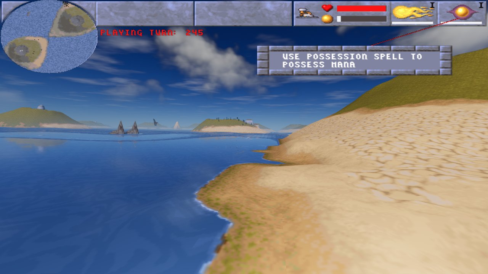
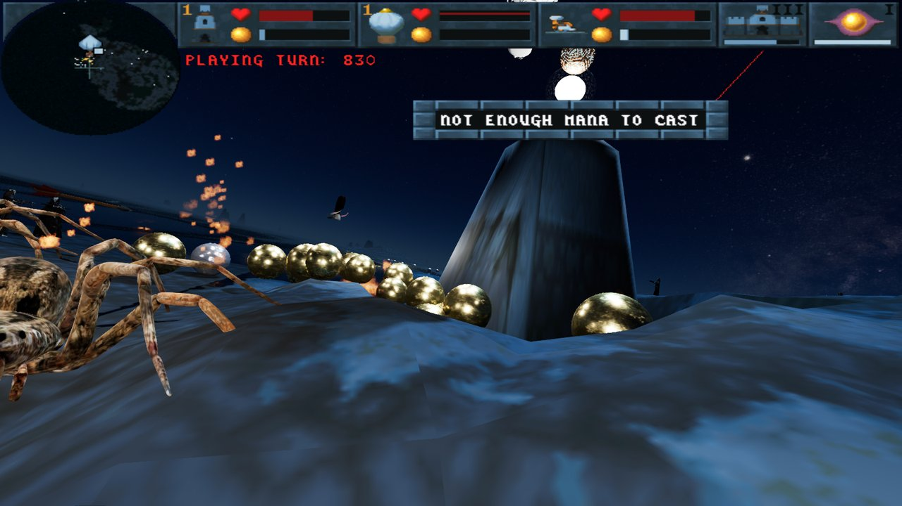
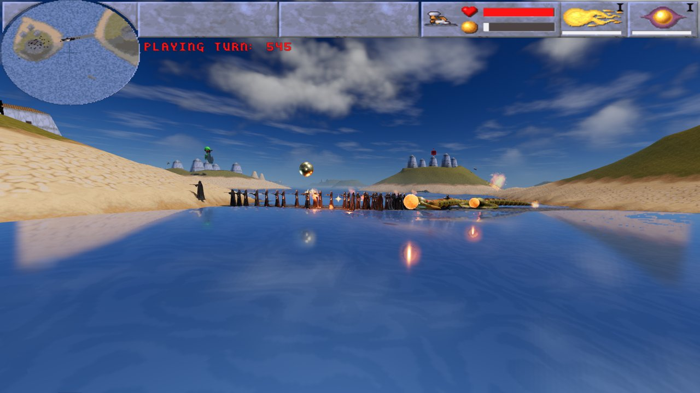
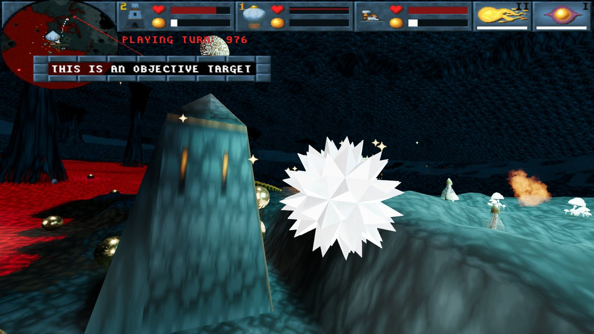
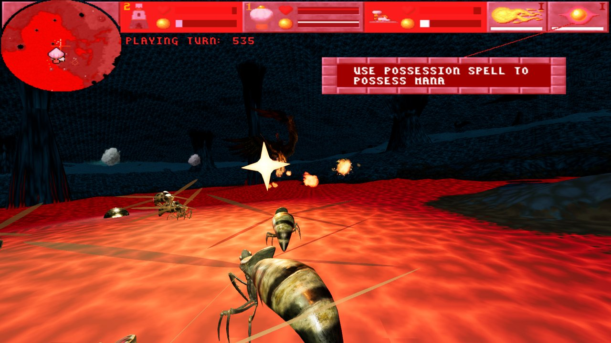
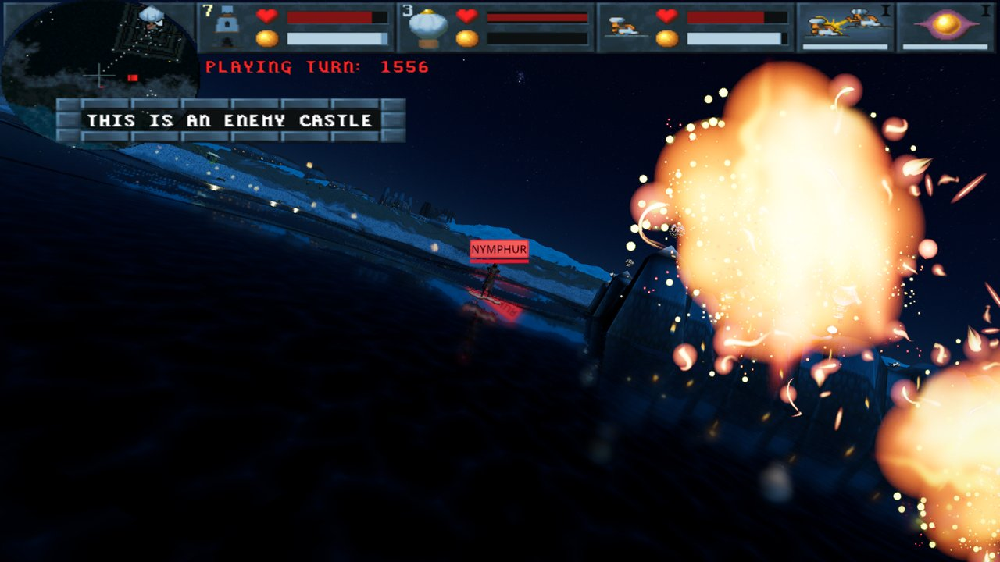
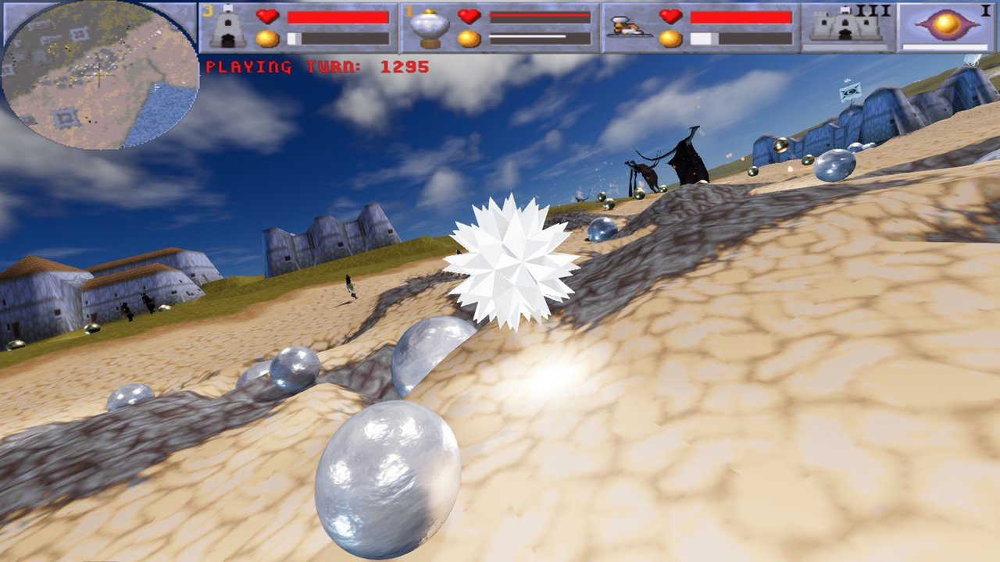
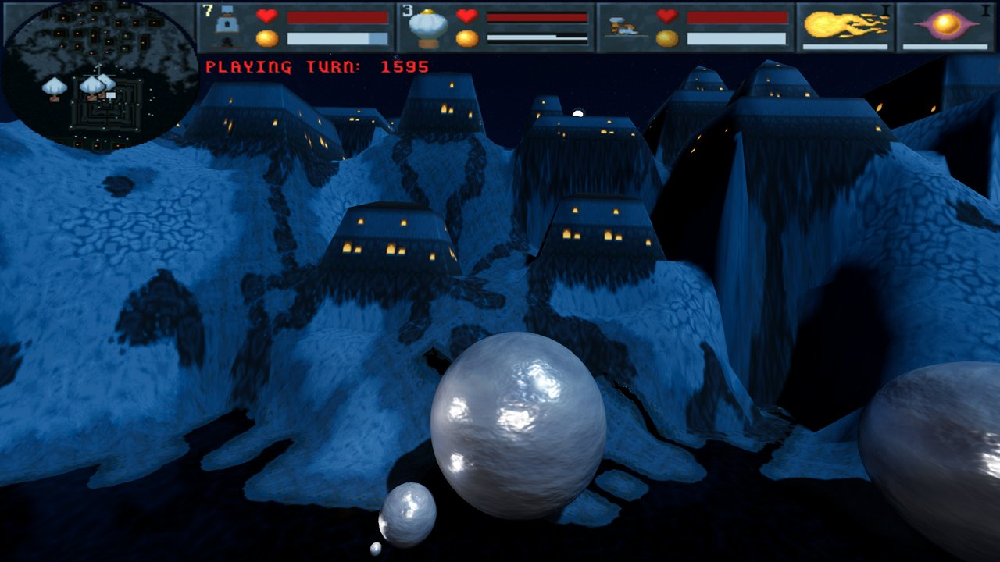
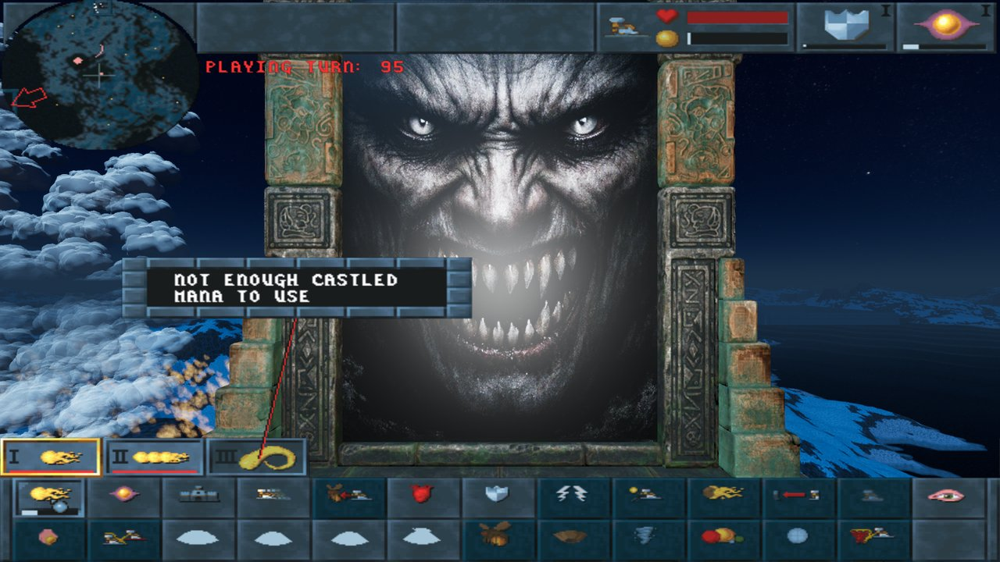

# MagicBalls
Rewrite game Magic Carpet 2 with Engine [GODOT](https://godotengine.org/) and REMC2 engine [REMC2](https://github.com/turican0/remc2)

# Screenshots
 
 
 
 
 

# Usefull links:
[Diskord of projects MDmod/remc2 and MagicBalls](https://discord.com/channels/1005849681995255878/1005849682464997378)
[REMC2](https://github.com/turican0/remc2)
[MC2 HDmod](https://github.com/thobbsinteractive/magic-carpet-2-hd)

# Information for testers:
1) Please be patient, but don’t hesitate to report bugs. The game’s optimization is still poor; I’ll continue to tune some models’ triangle counts and see if I can optimize the lighting and fire effects (especially in Meteor III), but don’t expect miracles :)
2) Document everything in an issue on GitHub. For specific bugs, note the level and location; for particularly random bugs, save the game using F5 before the crash and then attach the zipped folder "user\AppData\Roaming\Godot\app_userdata\MagicBalls\CDdata\GAME\NETHERW\SAVE\"
3) Report everything: bad models, incorrect sizes, wrong music, etc.
4) If you see text with numbers instead of an object, try to take a screenshot
5) Some features from the original game are missing, and the keyboard shortcuts listed in the original help menu don’t work either. Press F1 to see which keys are currently in use.
6) Please also add suggestions for improvements or additions to the original features in the issues.
7) If you’d like to contribute to development—whether you’re a graphic designer or a programmer—please reach out on Discord; any help is welcome.
8) Expect that I’ll be a bit clueless at times and will need to ask for help :)
9) If the game crashes or freezes, run it with `-- --debug-log` (e.g. `MagicBalls.exe -- --debug-log`) and attach the file `debug.log` from the user folder below - it shows how far the game got.

# How to install the game:
1) The game requires data from the original Magic Carpet™ 2: The Netherworlds. The installation now supports the GOG version https://www.gog.com/en/game/magic_carpet_2_the_netherworlds.
Please install that version. If you have a different version and can’t get it to install, create an issue, take a screenshot of the game folder, and I’ll add more options to the engine.
2) Download and extract the game from [the releases)](https://github.com/turican0/MagicBalls/releases) (Windows/Linux is supported, android is only experimental-mostly problem with graphics inicialization):
4) Run the .exe; the first time, the game will ask you for the installation path for MC2 (from GOG). Find it and confirm.
5) The first time, you’ll need to wait for the game to extract the files; subsequent launches will be faster.
6) The game saves user files to this folder, which also contains save files, etc. If you want to transfer them between the original game and the remake, or if you no longer need the game, you can delete this folder(you can use script removeUserMBFolder.bat):
user\AppData\Roaming\Godot\app_userdata\MagicBalls\

# For developers:
1) Use **Godot 4.7.2** (standard version, not .NET) - the same version the release builds use (`GODOT_VERSION` in `.github/workflows/releases.yml`).
2) Install **Blender 5.1** and set its path in Godot: Editor Settings → FileSystem → Import → Blender → Blender Path (the models in `godot-code` include `.blend` files).
3) Build the GDExtension (C++ code in `gitextension/godot-cpp-template`) with CMake, see `build_linux2.sh` or the workflow for the exact commands. The library is copied to `godot-code/MBEXout/bin/<platform>/`.
4) Open `godot-code` in Godot.

---

## What needs to be done to complete the game:
-Add gamepad controls, etc. 
-Add first-person/third-person camera options 
-Clean UP code and unused models 
-Optimalizatins 
-Some better 3D models 

---

## Next version (in progress):
-Much faster frames: level 5 from 19 ms to about 6 ms per frame (measured on one PC), the long stutters in level 25 (Meteor III) are gone 
-Entities are drawn from C++, hidden entities no longer run their animations 
-Lighter splash particles with seamless textures 
-The mouse is free while the game loads or runs in the background 
-Setting for the separate render thread (Video), off by default 
-Fixed the cave ceiling drawn without its texture 
-Linux: fixed the file search and the path of the game 
-Debug log for crash reports (`-- --debug-log`), sound debug output only with `-- --debug-sounds` 
-New look of the mana balls, Backspace and keypad Enter, default fog level, better mouse capturing 
-Fixed a heap corruption and a hang when quitting 

## Version 261023:
-Faster entity rendering: MultiMeshes, shared particle emitters, merged lights 
-Lighter heavy models and textures limited to 1024 px - less loading and memory 
-Faster level start: entities and wizards are prepared while the level loads 
-AWE32 music, sound and music setting fixes 

## Version 261003:
-Vulkan renderer, better shadows, water reflections fixed at the map edges 
-Much faster screen buffer conversion, terrain culling and texture uploads 
-Multiplayer settings tab 
-Fixed crashes on quit and in sound updates, FMV video timing 
-Godot 4.7.2, remc2 engine synchronized with upstream 

## Version 260619 - 260815:
-Godot 4.7 
-Help, level gates, better end of game 
-Editor: moving entities, fixes 
-Export of multiplayer backgrounds, Linux install instructions 

## Version 260524:
-Arab trader, switches, cloth flag, exits 
-Editor: "Go to entity", better selection, stage variables 
-Godot 4.6.3 

## Version 260517:
-Faster rendering on Android 
-Editor and visual effect updates 

## Version 260506 - 260508:
-Pause and spell menu on C, spells selected with the mouse wheel 
-F1 map menu, F2 help, F3 speed, X stop 
-FPS settings, roof visibility checkbox 
-Editor: select and run, editing wizards, undo/redo 

## Version 260424 - 260503:
-Custom levels: loading and selection 
-Installer, option to remove the user folder 
-Danger music 
-Linux and Android builds 
-Editor: stage player, editing of entities and terrain 

## Version 260406 - 260420:
-User keybindings, speech, OGG music and SF2 sound fonts 
-First version of the editor 

## Version 260405-alfa version - first release:
-There are so many improvements that it doesn't make sense to list them all 
-You can play through the game from start to finish 

## Version 260302:
-Many fixes and updates 
-Draw Spider Web 
-Draw Terrain modification by fire 
-Add models to level 1-5 
-Integrate data copier from Magic Carpet 2 
-Better terrain abilites(water/lava) 
-Add sounds/music. 
-Add menus/levels, etc. 
-Add proper water. 
-Add particle effects. 
[Second youtube video](https://www.youtube.com/watch?v=gSrJQ-UL85s)

## Version 260121:
-Add sounds 
-Add music 
-Add basic code to copy some data from original CD 
[First youtube video](https://youtu.be/SaIr8dyr_Rc)

## Version 260115:
-Draw minimap 
-Update UI-particaly 
-Add Ballon 3d model 
-Implement palette modifications (red or grayscale) 
-Add using mouse buttons 
-Add select spells 
-Add terrain changes 

## Version 260108:
A lot has changed in this version. I found that copying terrain in every frame is extremely demanding. 
The first tests showed less than 1 FPS. 
I had to put most things into the shader. After a series of struggles, I created a shader that: 
-handles reflections and water waves 
-I now send the height, index, and rotation maps to the shader as textures 
Thanks to this, I got up to 3-4 FPS. 
Then all I had to do was rewrite the key parts of the code from GDSCRIPT to C++, and I got up to 60 FPS. 
### Changes:
-Terrain rendering and updating moved to shader 
-Terrain work moved to C++ 
-Create true model for building possession 
-Add multimesh for objects(for corect visibility of objects) 
-Fix water reflections 
-Fix water waves 
-Copy terrain modification 

## Version 260104:
### Changes:
-Check spell disappearance-maybe-ok 
-Test mouse button 
-Add teplate spells fireball and possesion 
-Add mana spheres for gold and white 
-Test kill and possesion mana from goats 

## Version 260102:
### Changes:
-Add additional temporary models 
-Fix object display so they are always in front of the camera 
-Extend Multimesh terrain to 5x5 

## Version 260101:
### Changes:
-Test using first billboards and models(smoke and goat) 

## Version 251231:
### Changes:
-display entities (all as universal objects for now) 
-synchronize speed with engine (limit frame rate) 
-add rotation to REMC2 engine 

## Version 251230:
### Changes:
-fix terrain rendering triangles 
-add compute position of player by REMC2 
-add arrows input by REMC2 
-many cleanings in REMC2(copy new engine version) 

## Version 0:
### Changes:
-first render of terrain 

